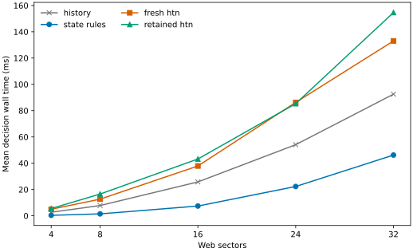
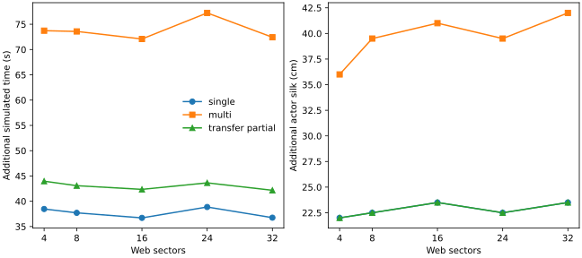
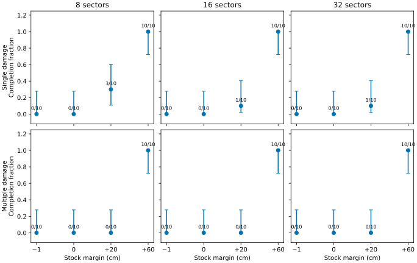
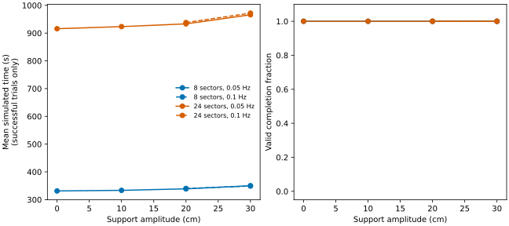

# E1 expanded conditions: manuscript results and figures

## Design

The [prespecified expanded protocol](../research/E1_EXPANDED_PROTOCOL.md) extends
E1 to five web sizes (4, 8, 16, 24 and 32 sectors), near-boundary silk stocks,
and stronger/faster support motion. The scaling and movement experiments use
1,000 cm of stock; the separate resource experiment uses the modeled intact
requirement, 19 cm per sector, plus −1, 0, 20 or 60 cm. Seeds 20–29 were not
used in the initial E1 sweep. Four controllers share physical preconditions and
observed state: cached-plan history, state rules, fresh IPyHOP and retained-tree
IPyHOP. Exact configurations, versions and source hashes are in the
[provenance manifest](../research/evidence/e1_expanded_v1/provenance.json).

The sweep comprises 2,400 scaling, 1,920 resource and 960 movement trials:
**5,280 trials**, or **1,320 matched four-controller cases**. Of these, 1,200
cases reached the intervention with identical pre/post observation hashes.
In the remaining 120, all four controllers failed before the intervention:
each had initial stock 1 cm below the model's intact requirement. These are
reported as unexposed, not as observations of a response to damage.

## Findings

For each of fresh HTN minus rules, retained HTN minus rules and retained minus
fresh HTN, completion outcomes matched in **1,320/1,320** cases. Of those,
**830 matched pairs completed under both controllers**; elapsed simulated time,
travel and actor silk usage were exactly equal for all 830 pairs. The other
490 pairs do not contribute successful-pair physical costs. There were no
unnecessary repetitions and zero recorded actor-stock conservation error.

Under multiple damage, 10 cm amplitude and 1,000 cm stock, every capable
controller completed 10/10 cases at every tested size. Their mean total
decision wall times in this run were:

| Sectors | State rules (ms) | Fresh HTN (ms) | Retained HTN (ms) |
|---:|---:|---:|---:|
| 4 | 0.371 | 4.987 | 5.515 |
| 8 | 1.479 | 12.688 | 16.577 |
| 16 | 7.454 | 37.913 | 43.228 |
| 24 | 22.309 | 86.270 | 85.333 |
| 32 | 46.216 | 133.045 | 154.647 |

The retained-minus-fresh mean at 24 sectors is −0.937 ms with a pointwise
paired bootstrap interval [−11.961, 8.241] ms. This does not establish a
reliable advantage at 24 sectors. At 32 sectors it is +21.602 ms, interval
[9.785, 35.946] ms. These intervals describe this run, with 10 seeds per
stratum, and are not adjusted for multiple comparisons. Timing measures
implementation wall time on one machine, including planner adapter work; it
is not biological time or a general computational-complexity result.

At 32 sectors, retained planning used 442.4 method calls on average versus
535.6 for fresh planning in this scenario; fewer calls did not imply lower
measured wall time. The cached-plan controller failed all these damaged cases,
so its decision-time line is a diagnostic and must not be interpreted as the
cost of successful recovery.

**Figure 1.** Mean controller decision wall time for multiple damage, 10 cm
amplitude, 0.05 Hz and 1,000 cm initial stock; 10 seeded trials per point.
The cached-plan controller failed all cases. Time excludes physical execution
and diagnostic tree recording. See the paired CSV for pointwise intervals.

**Figure 2.** Mean paired differences relative to intact construction in the
same size/amplitude/seed, for state rules; both HTN variants match these
successful physical outcomes in this study. Each point has 10 successful pairs.
Transfer includes 5 s handling and separately records imported donor silk.
Y-axes show the plotted value ranges and do not start at zero. The imposed
geometry and silk costs are model assumptions, not biological measurements.

At the silk boundary, the capable controllers again agreed case by case. At
−1 cm margin none of the controllers reached the event. At +20 cm, single
damage completed in 3/10, 1/10 and 1/10 cases for 8, 16 and 32 sectors,
respectively; multiple damage completed in 0/10 for each size. With +60 cm,
all three capable controllers completed 10/10 in both cases at each size.
These are discrete tested settings; they do not identify a continuous or
biological threshold.

**Figure 3.** Completion under single and multiple damage by stock margin
above the modeled intact requirement. The three capable controllers have
identical outcomes for each seed, so one curve represents all three. Points
are categorical, with 10 seeded trials each; error bars are pointwise 95%
Wilson intervals. At −1 cm, none reached the damage event. The cached-plan
diagnostic is omitted from this figure and completed 0/10 in these disruption
cases. This figure was regenerated from the saved trial data by the separately
hashed `e1_expanded_figures.py`; the initial unrefined graph remains in the
bulk experiment output.

**Figure 4.** Single-damage outcomes for the state-rule controller with 8 or
24 sectors; fresh and retained HTN have identical physical outcomes on matched
cases. Lines at 0.05 Hz use 0/10 cm scaling-suite cases and 20/30 cm
movement-suite cases; dashed 0.10 Hz lines include only 20/30 cm. Each point
contains 10 trials, all completed; therefore the completion lines overlap.
Time is conditional on success. These cross-suite descriptive comparisons
are exploratory. The motion is an imposed affine support model, not measured
wind or spider behavior.

## Scope and reproducibility

The enlarged sweep strengthens the tested range and exposes resource-boundary
behavior. It does not show an HTN completion or physical-cost advantage over
the equally informed rule controller. Nor does it demonstrate that a spider
uses HTN planning, that geometry was predicted from behavior, or that stronger
modeled support motion represents a biological experiment. The same PRNG seed
selects phase and target through separately initialized generators; the 10
seeds in each stratum are not 10 animals. No multiple-testing correction is
applied to descriptive pointwise intervals.

- [All 5,280 trial rows](../research/evidence/e1_expanded_v1/trials.csv),
  [summaries](../research/evidence/e1_expanded_v1/summary.json),
  [paired contrasts](../research/evidence/e1_expanded_v1/paired.csv) and
  [exact cross-controller audit](../research/evidence/e1_expanded_v1_summary.json).
- Full local output, including first-seed traces:
  `mulder_results/e1_expanded_v1_20261113/`.
- Main reproduction: `python3 -m spider_web_recovery.e1_expanded --output
  mulder_results/NEW_UNIQUE_DIRECTORY`.
- Resource figure reproduction: `python3 -m
  spider_web_recovery.e1_expanded_figures --trials
  docs/research/evidence/e1_expanded_v1/trials.csv --output-stem
  /private/tmp/e1_resource_new`.
- Software verification: 231 tests passed. This is separate from computational
  experiment evidence and does not constitute empirical biological validation.
