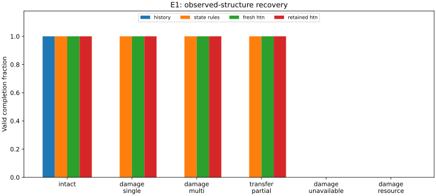

# E1: recovery from observed web structure

## Motivation and scope

Partial-web transfer and flexible use of construction cues motivate separating
action history from the structure currently available to an actor
[@peters1970configuration; @eberhard2019flexibility]. We test this distinction
in a computational sector-construction model. The model does not reproduce
either animal protocol, estimate biological parameters, or establish that
spiders perform HTN planning. The contribution is a controlled comparison of
construction controllers using existing planning software.

## Methods

E1 reuses the recovery-v1 symbolic domain and the Mulder-v3 continuous tracking
executor. A scaffold, hub, primary/backup anchors and sector geometry are supplied
as initial conditions. Radii are traversable edges; capture effects depend on
two adjacent valid radii. Capture construction is a symbolic operation costing
5 cm of model silk and 0.5 s, not a simulated spiral trajectory. Ideal sensing
and no-slip support advection remain assumptions.

We compare four controllers: a cached initial plan (`history`, a diagnostic
ablation), a current-state finite-state/rule controller (`state_rules`), fresh
IPyHOP planning (`fresh_htn`) and retained-tree IPyHOP (`retained_htn`). The latter
uses upstream revision `bdda21012b2396aed9a91980af8fbb71dbcb7075` and re-enters
at the actual next queued action-node identifier. All controllers share physical
preconditions and final-goal validation. Capable controllers share structure
observations, routing, primary/backup choices and a necessary resource bound.
Rule selection is hand-authored, as are the HTN methods; neither controller learns.

After all radii and the first half of capture sectors are constructed, the actor
receives one observation/event at the hub: intact sham, single-anchor damage,
two-anchor damage, aligned partial-web transfer, loss of both anchors for one
radius, or single-anchor damage plus insufficient remaining silk. The transfer
replaces the current effects with a donor web using backup radii except for one
missing radius. Existing donor captures survive only where their dependencies
are present. Position remains at the aligned common hub; external displacement
is explicitly zero and handling costs 5 s. Actor expenditure and stock carry
over. Imported donor and displaced web silk are separate quantities. Damage
never refunds silk. Reconstruction of invalidated effects is distinct from
unnecessary repetition of still-valid work.

The frozen [protocol](../research/E1_PROTOCOL.md) crosses four controllers, six
scenarios, 4/8 sectors, stationary/10 cm support amplitudes at 0.05 Hz and seeds
0–19: **1,920 trials**. Depth is zero; stock is 500 cm, speed 1 cm/s, and budgets
are 500 actions, 20 replans and 20,000 simulated seconds. Each seed selects
forcing phase and target sector, not a biological individual. Controller run
order rotates with seed. Checkpoint hashes establish identical pre/post event
state within each matched case. Tree snapshots are disabled for primary timings;
separate diagnostic runs retain trees. Software validation preceded the sweep.

Completion intervals use Wilson's method within size/amplitude/scenario strata
(20 seeds each). Pairwise differences compare fresh HTN minus rules, retained
HTN minus rules and retained minus fresh HTN. Computational comparisons include
failures; physical costs require both constructions to succeed. Pointwise paired
bootstrap intervals use 2,000 resamples and analysis seed 20261112. These are
descriptive summaries, without multiplicity adjustment or population inference
about animals. Decision wall time measures controller/adapter work on one machine,
not a complexity bound or biological cost; method counts are comparable only
between the same-engine HTN controllers.

## Results

All **480 matched cases** reached the checkpoint with identical pre/post hashes
across the four controllers. Actor-stock conservation held exactly in the
recorded trials, and no controller repeated a still-valid construction effect.

| Scenario | Cached plan | State rules | Fresh HTN | Retained HTN |
|---|---:|---:|---:|---:|
| Intact sham | 80/80 | 80/80 | 80/80 | 80/80 |
| Single damage | 0/80 | 80/80 | 80/80 | 80/80 |
| Multiple damage | 0/80 | 80/80 | 80/80 | 80/80 |
| Partial-web transfer | 0/80 | 80/80 | 80/80 | 80/80 |
| Both anchors unavailable | 0/80 | 0/80 | 0/80 | 0/80 |
| Insufficient silk | 0/80 | 0/80 | 0/80 | 0/80 |

Each cell pools two sizes, two amplitudes and 20 seeds. Within each stratum,
20/20 completion has a Wilson interval approximately [0.839, 1], while 0/20
has [0, 0.161]. The infeasible cases are intended negative controls: all capable
controllers terminate with `planning_infeasible`, rather than reporting an
empty plan as success. Across the 400 disrupted cached-plan trials, 222 stop
at a stale precondition and 178 exhaust the plan with an unsatisfied physical
goal. A cached plan can therefore fail even when its remaining commands happen
to remain executable.

For each of the three prespecified contrasts, completion agrees in **480/480
pairs**. In the **320 pairs with both constructions complete**, elapsed time,
travel and actor silk expenditure agree exactly, trial by trial. All corresponding
stratified paired differences and bootstrap intervals are zero. The 160 infeasible
pairs per contrast have no eligible physical-cost comparison; their costs are
not treated as zero. This is equality within the tested model and conditions,
not a general equivalence theorem.

Mean total controller decision wall times (ms), pooled over the same 80 trials
per scenario/controller, were:

| Scenario | State rules | Fresh HTN | Retained HTN |
|---|---:|---:|---:|
| Intact sham | 0.696 | 5.349 | 5.335 |
| Single damage | 0.839 | 8.946 | 9.892 |
| Multiple damage | 0.927 | 9.252 | 10.434 |
| Partial-web transfer | 0.822 | 8.610 | 9.473 |
| Both anchors unavailable | 0.682 | 5.813 | 10.218 |
| Insufficient silk | 0.679 | 5.478 | 10.309 |

Retained planning uses fewer mean method calls in feasible changed-structure
cases: 93.95 versus 111.30 for single damage, 101.775 versus 117.85 for multiple
damage, and 92.95 versus 110.30 for transfer. Yet its mean decision wall time
is higher in each of these scenarios. In both infeasible scenarios it uses
91 versus 70 mean method calls. These pooled means are descriptive; the
stratified paired intervals and recovery-only timings are retained in the
evidence files. Method-call savings do not imply a runtime improvement.



Figure: each bar includes 80 trials; the complete denominators and intended
negative-control failures are shown in the table above. Zero-height bars are
zero completion. This figure displays computational outcomes, not animal data.

## Interpretation and limitations

Current-state rules and both HTN controllers recover from the imposed changes
without rebuilding intact effects. The cached-plan ablation establishes the
importance of checking current physical structure, but the equally informed
rule controller achieves the same outcomes with lower measured decision time.
**E1 does not support an HTN or retained-tree performance advantage.** Its
scientific value is a reproducible boundary case showing that the supplied
repair knowledge and observations suffice without hierarchical search.

Authored geometry, complete observations, simple resource accounting, fixed
repair order and aligned transfer restrict generality. This benchmark does not
test uncertain sensing, arbitrary transport, emergent web geometry, learning,
or biological stage-sequence prediction. Retained re-entry is implemented using
existing upstream software, not a new recovery algorithm or a full replication
of its published evaluation. E2 and E3 remain proposed follow-ups.

## Evidence and reproduction

A separate [expanded study](e1_expanded_results.md) tests sizes through 32
sectors, additional resource and movement conditions, and new seeds. Its
findings remain distinct from the original 1,920-trial E1 analysis above.

- [Curated summary and exact pair audit](../research/evidence/e1_v1_summary.json).
- [All 1,920 trial records](../research/evidence/e1_v1/trials.csv),
  [stratified summaries](../research/evidence/e1_v1/summary.json), and
  [paired contrasts](../research/evidence/e1_v1/paired.csv).
- [Settings, versions and source hashes](../research/evidence/e1_v1/provenance.json).
- [Acceptance checks and review](../research/E1_REVIEW.md).

Run from the repository root with a new output directory:

```sh
python3 -m spider_web_recovery.e1_benchmark --output mulder_results/e1_new_run
```

The original run is `mulder_results/e1_v1_20261112`; source and artifact SHA-256
manifests preserve its identity. The run was made on `development/E1` above
`61d18d8`, with uncommitted E1 source identified by its hashes. Historical Mulder,
recovery and adaptive-planner numerical artifacts were not rewritten.
