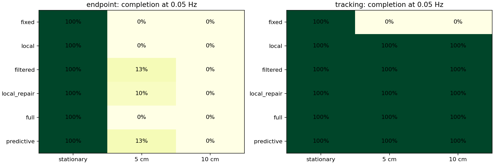
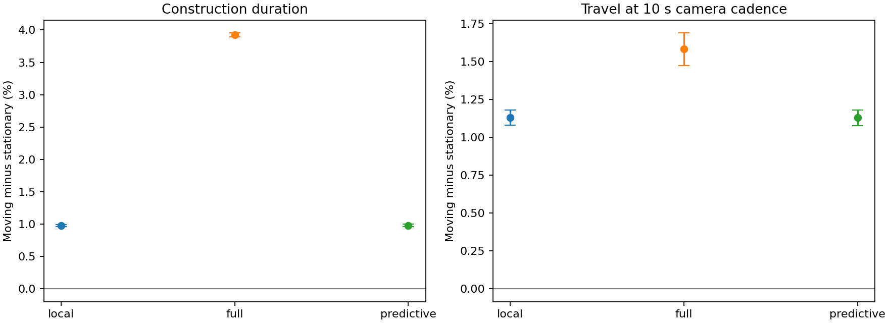

# Draft section: hierarchical construction under moving supports

Status: reusable manuscript prose for the version-3 computational study.
Numbers are tied to ../research/evidence/mulder_v3_summary.json. This section
does not claim empirical biological calibration or implementation of IPyHOP.

## Experimental motivation and model

Mulder et al. studied orb-web construction under rigid and periodically moving
supports and did not detect statistically significant differences in the
analysed construction and geometry measurements [@mulder2021dynamic]. Their
sample comprised five spiders completing the experimental regime; this limits
the inference to that selected sample. The present study tests candidate
computational mechanisms for construction tolerance rather than identifying
the animals' internal planning representation or independently verifying their
observations.

The simulated support is a 30 × 30 cm frame with a fixed top and sinusoidally
translated bottom. For material coordinates (x,y), the room-frame horizontal
coordinate is x + (1−y/H) A sin(2πft+φ). This affine deformation approximates
the flexible apparatus. We used peak amplitudes of 5 and 10 cm and frequencies
of 0.049 and 0.05 Hz. The reported approximately 40° shear swing is consistent
with a roughly 10 cm peak displacement under the affine approximation; the
5 cm condition provides an apparatus-sensitivity comparison. Affine shear
preserves area, an important restriction when interpreting geometric invariance.

The construction generator specifies frame edges, definitive radii, auxiliary
spiral turns and capture spiral turns. HTN methods group these segments into
components. Counts, ideal geometry and traversal access are supplied domain
knowledge. They are not emergent predictions of a biological model. The model
does not simulate exploration, detailed thread mechanics, damaged supports or
graph-constrained navigation.

## Execution and control

Two execution models separate planning policy from movement assumptions.
The endpoint model moves toward a saved room-frame target and optionally makes
one bounded correction. The continuous model updates the sensed destination
during locomotion, bounds motion relative to the instantaneous supporting
geometry, and assumes no-slip passive advection. Attachment dwell is separate
from locomotion. The default tracking model has ideal zero-lag sensing; sensor
lag, locomotion speed, numerical step, attachment tolerance and repair delay
are varied independently in sensitivity profiles.

Six policies share each executor: fixed execution, local feedback, local
feedback with reactive component refresh, filtered-drift component refresh,
full remaining-plan refresh, and predictive component refresh. Endpoint
prediction samples drift; tracking prediction uses a deformation-dependent
duration bound and a sensory-lag estimate. These margins are model-dependent
estimates, not general robustness guarantees. All repair-capable policies use
the same failed-attachment retry budget. Planning and prediction overhead are
recorded separately from configured simulated repair delays.

## Recovery semantics and related work

Our actor records accepted segment indices and calls GTPyhop afresh on the
current component or remaining web. Domain methods omit completed indices.
Component refresh retains later cached actions; it does not retain or re-enter
a solution task tree. The actual position and costs of failed motion remain
in the executor. Neither search backtracking nor retries represent physical
retracing. Route repair, damaged-thread effects and partial failed silk are
not implemented.

This approach differs from IPyHOP and Run-Lazy-Refineahead, which preserve a
task-decomposition network and revise it from execution-failure context
[@bansod2021reentrant; @bansod2022middle]. In particular, Bansod et al.'s
dependent-suffix example explains why replanning only a failed action's parent
can be insufficient when later refinements rely on changed effects. The
present component-refresh mechanism does not solve that general problem.
Retained-tree recovery is therefore relevant prior work and a proposed
comparison, not a new algorithm implemented in this study.

A subsequent environment audit identified GTPyhop 1.9.7's fresh-process default
as iterative greedy search. The study runner did not explicitly pin or record
its search strategy. A standalone conformance probe confirms that this default
does not revisit an earlier applicable method after a descendant fails, whereas
explicit iterative DFS backtracking can. Consequently, the historical study
does not establish full-backtracking performance or search completeness.
Future backend comparisons must pin and report their strategies.

## Measurements and statistical analysis

The study contains 2,280 trials. Primary executor comparisons use 30 paired
initial forcing phases; ten additional sensitivity and ablation profiles use
12 phases each. A stationary control is executed once per seed, profile and
controller, then reused across frequency comparisons. These phases are
simulation units, not simulated biological individuals.

Measurements include completion, elapsed time, true frame-corrected travel,
travel sampled at a 10 s camera cadence, construction-phase allocation,
planning/monitoring cost and geometric quantities based on Table 1 of the
biological study. Areas are estimated from polygonal envelopes of accepted
chords. Cardinal ray intersections provide capture counts and widths; shared
vertices are deduplicated. Capture area subtracts an estimated hub envelope.
Eccentricity uses |1−width/height|, and mean mesh space uses summed north/south
capture widths divided by summed counts minus two. Frame work remains a
separate category rather than being silently assigned to the paper's radial
phase. Final geometry is missing for incomplete constructions.

Completion uncertainty is reported using Wilson 95% intervals. Continuous
outcomes use paired-bootstrap contrasts against stationary controls, resampling
whole phases with 2,000 replicates and a fixed analysis seed. Those contrasts
include only pairs in which both runs complete, with pair counts reported.
Intervals are pointwise and descriptive. The analysis neither reproduces the
paper's repeated-spider mixed models nor establishes biological equivalence.

## Results

At 10 cm peak amplitude and 0.05 Hz, all six policies using endpoint execution
failed to complete in 30 trials each. With continuous tracking, local feedback,
reactive local repair, filtered refresh, full refresh and predictive refresh
each completed 30/30; fixed execution remained unsuccessful. The Wilson
interval for 30/30 is approximately 0.8865–1, illustrating the uncertainty
despite an observed 100% completion rate.

For local tracking, mean construction duration was 1491.076902 s under movement
and 1476.595732 s in stationary controls. The paired increase was 0.980713%
(95% bootstrap interval 0.963429–0.996403%). Full refresh also completed all
trials but increased duration by 3.923865% (3.893372–3.953719%). Predictive
tracking matched local feedback's outcomes in this primary condition and
provided no demonstrated completion advantage.

Camera-sampled travel under local tracking increased from 1123.326247 cm to
1136.020333 cm, a paired increase of 1.130044% (1.079618–1.180734%). These small
but nonzero model effects should not be described as reproducing the paper's
non-significant biological tests. Confidence intervals quantify variability
over forcing phase only.

Flat execution of the same prescribed segment sequence matched the hierarchical
local-controller duration exactly on 12 matched moving trials. The experiment
therefore does not establish that HTN decomposition is necessary for the
observed tolerance. The alternative phase_wait method was slower by a mean
22.703291 s relative to the matched slow-tracking baseline. Both one- and
five-second sensory-lag profiles completed 0/12 moving trials, showing that
the ideal-sensing assumption materially affects outcomes.

Figure draft caption: Completion in stationary and moving conditions at 0.05 Hz.
Each cell represents 30 initial phases. Endpoint and tracking executors differ
in their movement assumptions; this is not a comparison of biological cohorts.

Figure draft caption: Paired moving-minus-stationary percentage changes at
10 cm and 0.05 Hz, conditional on both constructions completing. Error bars
are pointwise 95% paired-bootstrap intervals over 30 forcing phases. Configured
repair delays are included in construction duration; CPU time is recorded
separately. Exact source figures and hashes are retained with the evidence.

## Interpretation and limitations

Under the assumed substrate contact and ideal sensing, local tracking is
sufficient for completion in these conditions. The primary study supports
neither an HTN advantage over the supplied flat sequence nor a predictive-
repair advantage over local feedback. Invariance of prescribed endpoints,
counts, much of the geometry and true corrected travel is partly imposed by
the model and cannot independently validate biological geometric tolerance.

The paper's raw cohort observations have not been supplied. Rigid-only fitting
and held-out moving-observation comparison are implemented as data-import
capabilities but have not been performed on that cohort. Speed, sensing,
contact, geometry and route assumptions therefore remain uncalibrated. More
general hierarchical recovery requires a richer observed-state abstraction,
real method alternatives, valid structural dependencies and failure cases
that cannot be resolved by coordinate refresh alone.
