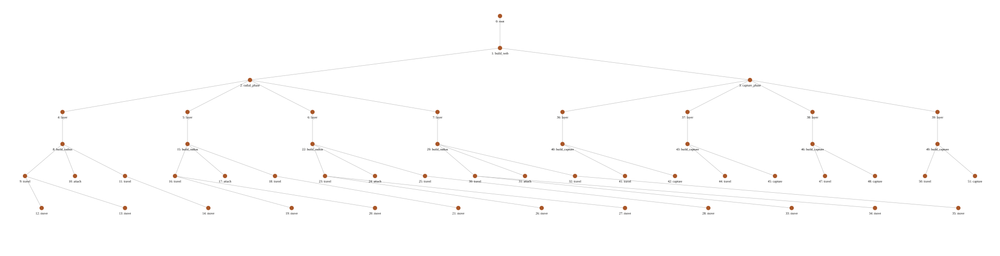
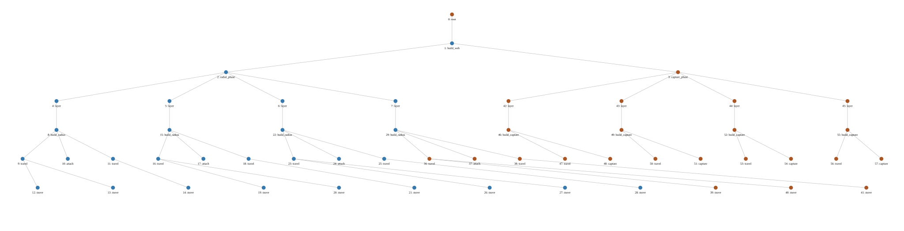

# Draft section: observed-state hierarchical recovery

This is a separate recovery study, not an extension of the sample size of the
Mulder v3 comparison. Evidence: ../research/evidence/recovery_v1_summary.json.
Implementation: spider_web_recovery. Earlier Mulder policy results are retained.

## Methods

We integrated the upstream IPyHOP planner described by Bansod and colleagues
[@bansod2021reentrant; @bansod2022middle]. Source revision
bdda21012b2396aed9a91980af8fbb71dbcb7075 was vendored without modification,
preserving its BSD-3-Clause license. The adapter maps planned actions to
solution-tree leaves and calls replan with the observed state and failed node
identifier. Suffix un-refinement and planner backtracking are performed by
IPyHOP rather than an invented reconstruction of a flat plan.

The shared sector-construction domain represents current position, scaffold
and radial edges, blocked routes, attachment availability, valid radii and
capture effects, remaining silk and elapsed time. Travel uses graph-valid
paths and the v3 continuous executor on each edge. Scaffolds exist initially;
completed valid radii add traversable edges. Capture sectors are abstract
resource-consuming operations with explicit dependencies on adjacent radii,
not detailed simulations of capture-spiral locomotion or silk mechanics.

Execution history is recorded separately from valid physical effects. The
observer invalidates radii and capture sectors when attachment support is lost.
Authored methods restore required structure. Failed attempts preserve actual
position and consumed time/resource. Replanning does not reset the spider to a
hub or restore spent silk. Transient failures are retried within a budget
without permanent command blacklisting; permanent failures update observations.
A shared necessary resource bound rejects known infeasibility consistently.

Four backends use the same domain: fresh-root GTPyhop planning with explicit
iterative DFS backtracking, component-only GTPyhop refresh retaining cached
later actions, fresh-root IPyHOP, and retained-tree IPyHOP. The same-engine
IPyHOP pair isolates retention more closely than a cross-engine comparison,
since the engines evaluate alternatives differently. The actor checks immediate
preconditions and actual outcomes; this is not a verbatim reproduction of the
paper's entire Run-Lazy-Refineahead evaluation or full-suffix physical simulator.

The study comprises 2,240 cases: four backends, seven scenarios, ten seeds,
two sector counts (4/8), two wrapper depths (0/2) and stationary/moving supports
(0/10 cm at 0.05 Hz). Wrapper depth increases nested refinement nodes rather
than adding semantically distinct construction choices. Cases share explicit
logical-action event triggers, not a common absolute event time. Event exposure
is recorded. Seeds select initial motion phase and target attachment sector.

Scenarios are clean execution, a transient attachment miss, permanent primary
attachment failure, blocked route, unreachable route, silk depletion, and
damage to already completed structure. Recovery, actor-attempt and elapsed-time
limits are explicit. Planning infeasibility is not mistaken for success when
the upstream API returns an empty plan. Resource conservation checks account
for used, remaining and externally lost silk.

## Results and interpretation

For each backend, the five feasible scenarios completed 80/80 declared cases
per scenario. The unreachable and resource-infeasible scenarios completed
0/80 and terminated as infeasible. These pooled counts cover different size,
depth and amplitude strata; they are descriptive, not estimates for a single
biological population. Stratified intervals and complete settings are saved.

Permanent attachment change caused the component-only policy to encounter
two additional stale downstream preconditions and require three replanning
calls on average, compared with one recovery and no stale preconditions for
retained-tree IPyHOP. The actor rejected invalid cached commands rather than
executing them. Fresh-root planning also avoided those stale commitments.

In the 8-sector, depth-2, 10 cm condition, retained minus fresh IPyHOP method
calls were −19.6 (pointwise paired 95% bootstrap interval −24.8 to −14.4) for
permanent attachment failure and −10.0 (−11.2 to −8.8) for a blocked route.
Prefix damage required explicit reconstruction and yielded a −38.0 call
difference in that stratum. No still-valid completed work was blindly repeated
in the tested cases; reconstruction of invalidated work was counted separately.

The advantage was not universal. Some infeasible resource cases required more
method calls under re-entry than under fresh IPyHOP. Computational contrasts
therefore include failed cases, while construction-cost contrasts condition
on both runs completing. planning_wall_s includes adapter and tree-snapshot
overhead; method-call reductions are not asserted to be universal wall-time
speedups. Pointwise intervals resample matched seeds within each stratum.

The results demonstrate the retained-tree integration and the expected
dependent-suffix failure mode in this authored domain. They do not establish
a new general recovery algorithm, empirical spider cognition, arbitrary
roadblock handling, or a reproduction of the RoboSub results. Domain-specific
completion guards, damage observation, restoration methods and a second route
re-evaluation method remain necessary engineering choices supplied equally to
all backends.

## Reproducibility

```sh
python3 -m spider_web_recovery --seeds 10 --trace --output mulder_results/recovery_v1_verified
python3 -m pytest -q spider_web_recovery/tests spider_web_mulder/tests spider_web_htn_updated/tests
```

The experiment records source hashes, upstream provenance, exact case settings,
runtime versions, state transitions, tree generations, failed leaf identifiers,
repair counts and graph traversal. The existing Mulder configuration and
historical numerical results were not altered to produce this study.





Figure draft caption: Actual upstream task-tree snapshots before and after a
permanent anchor failure in the four-sector, depth-0, moving-support case,
seed 0. Blue nodes retain old refinements; orange nodes are newly refined.
Detailed arguments and failed-node identity are retained in
../research/evidence/recovery_example/trees.json and the action ledger.
