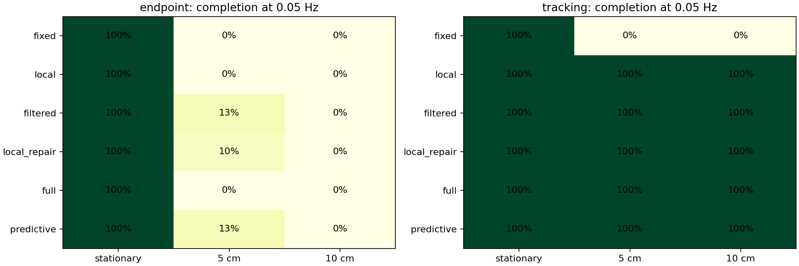
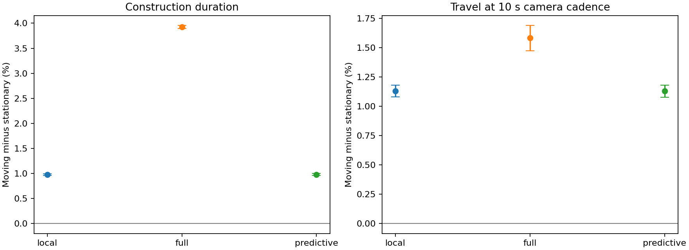

# Mulder paper comparison — model version 3

This is a computational comparison with the published pattern, not independent verification of the biological experiment.
Raw biological observations are not bundled with the paper. No data were fabricated or digitized approximately from bar charts.

**Trials run: 2280.** Paired bootstrap intervals use initial motion phases as simulation units, not biological spiders.
Continuous costs below use only pairs in which both conditions complete. Failures remain in completion rates.

## Completion at the published frequency

Stationary controls are executed once per controller/profile/seed and reused for frequency comparisons.

| Executor | Controller | Amplitude cm | Completed | 95% Wilson interval |
|---|---|---:|---:|---|
| endpoint | fixed | 5 | 0/30 | 0.000–0.114 |
| endpoint | local | 5 | 0/30 | 0.000–0.114 |
| endpoint | filtered | 5 | 4/30 | 0.053–0.297 |
| endpoint | local_repair | 5 | 3/30 | 0.035–0.256 |
| endpoint | full | 5 | 0/30 | 0.000–0.114 |
| endpoint | predictive | 5 | 4/30 | 0.053–0.297 |
| endpoint | fixed | 10 | 0/30 | 0.000–0.114 |
| endpoint | local | 10 | 0/30 | 0.000–0.114 |
| endpoint | filtered | 10 | 0/30 | 0.000–0.114 |
| endpoint | local_repair | 10 | 0/30 | 0.000–0.114 |
| endpoint | full | 10 | 0/30 | 0.000–0.114 |
| endpoint | predictive | 10 | 0/30 | 0.000–0.114 |
| tracking | fixed | 5 | 0/30 | 0.000–0.114 |
| tracking | local | 5 | 30/30 | 0.886–1.000 |
| tracking | filtered | 5 | 30/30 | 0.886–1.000 |
| tracking | local_repair | 5 | 30/30 | 0.886–1.000 |
| tracking | full | 5 | 30/30 | 0.886–1.000 |
| tracking | predictive | 5 | 30/30 | 0.886–1.000 |
| tracking | fixed | 10 | 0/30 | 0.000–0.114 |
| tracking | local | 10 | 30/30 | 0.886–1.000 |
| tracking | filtered | 10 | 30/30 | 0.886–1.000 |
| tracking | local_repair | 10 | 30/30 | 0.886–1.000 |
| tracking | full | 10 | 30/30 | 0.886–1.000 |
| tracking | predictive | 10 | 30/30 | 0.886–1.000 |

## Paired moving–stationary differences

Tracking execution, 10 cm amplitude, 0.05 Hz. Relative mean differences and paired 95% bootstrap intervals.
No threshold for biological equivalence is assumed. Small or non-significant differences do not establish biological equivalence.

| Controller | Measurement | Successful pairs | Mean change % | 95% interval % |
|---|---|---:|---:|---|
| local | elapsed_s | 30 | 0.981 | 0.963–0.996 |
| local | travel_cm | 30 | -0.000 | -0.000–-0.000 |
| local | sampled_travel_10s_cm | 30 | 1.130 | 1.080–1.181 |
| local | radials_time_pct | 30 | -0.413 | -0.432–-0.394 |
| local | auxiliary_time_pct | 30 | 0.357 | 0.278–0.435 |
| local | capture_time_pct | 30 | 0.299 | 0.289–0.310 |
| full | elapsed_s | 30 | 3.924 | 3.893–3.954 |
| full | travel_cm | 30 | -0.000 | -0.000–-0.000 |
| full | sampled_travel_10s_cm | 30 | 1.584 | 1.473–1.689 |
| full | radials_time_pct | 30 | -2.153 | -2.169–-2.136 |
| full | auxiliary_time_pct | 30 | 2.737 | 2.671–2.798 |
| full | capture_time_pct | 30 | 1.932 | 1.920–1.944 |
| predictive | elapsed_s | 30 | 0.981 | 0.964–0.998 |
| predictive | travel_cm | 30 | -0.000 | -0.000–-0.000 |
| predictive | sampled_travel_10s_cm | 30 | 1.130 | 1.079–1.180 |
| predictive | radials_time_pct | 30 | -0.413 | -0.432–-0.394 |
| predictive | auxiliary_time_pct | 30 | 0.357 | 0.279–0.439 |
| predictive | capture_time_pct | 30 | 0.299 | 0.289–0.310 |

## Sensitivity and hierarchy results

10 cm, 0.05 Hz. Differences are against each profile's own stationary control; speed profiles must not be compared as if they had equal absolute cost.

| Profile | Controller | Moving completions | Duration change % |
|---|---|---:|---:|
| tracking_dt_half | local | 12/12 | 0.903 |
| tracking_dt_half | predictive | 12/12 | 0.903 |
| tracking_slow | local | 12/12 | 1.008 |
| tracking_slow | predictive | 12/12 | 1.008 |
| tracking_fast | local | 12/12 | 0.951 |
| tracking_fast | predictive | 12/12 | 0.951 |
| sensor_lag_1s | local | 0/12 | no completed pairs |
| sensor_lag_1s | predictive | 0/12 | no completed pairs |
| sensor_lag_5s | local | 0/12 | no completed pairs |
| sensor_lag_5s | predictive | 0/12 | no completed pairs |
| tracking_tight | local | 12/12 | 0.980 |
| tracking_tight | predictive | 12/12 | 0.980 |
| repair_delay_1s | local | 12/12 | 0.980 |
| repair_delay_1s | predictive | 12/12 | 0.980 |
| flat_tracking | local | 12/12 | 0.980 |
| flat_tracking | predictive | 12/12 | 0.980 |
| phase_wait | local | 12/12 | 1.806 |
| phase_wait | predictive | 12/12 | 1.806 |
| flat_slow | local | 12/12 | 1.008 |
| flat_slow | predictive | 12/12 | 1.008 |

The ideal continuous local controller completes 30/30 primary moving trials. Its performance must be read alongside lag sensitivity and prescribed-geometry assumptions.

- flat_tracking versus tracking, matched local-controller seeds: mean duration difference **0.000000 s** across 12 completed pairs.
- phase_wait versus tracking_slow, matched local-controller seeds: mean duration difference **22.703291 s** across 12 completed pairs.

## Measurement and calibration status

- Frame dimensions, approximate forcing frequency, and the 10 s tracking cadence come from the paper. Peak amplitude is explicitly swept at 5 and 10 cm to cover the ambiguous movement wording.
- Areas are polygonal-envelope estimates from accepted chords. Capture area subtracts an estimated hub envelope. These are not ImageJ pixel measurements.
- Cardinal capture counts, radial count, mesh width/count formula, and eccentricity formula follow Table 1. Failed webs have missing final-geometry values.
- Frame time remains a separate construction category. Phase percentages use total construction time including frame activity; do not silently equate frame work with the paper's radial phase.
- Continuous frame-corrected travel and camera-sampled travel are both reported. The latter is comparable in observation cadence, not guaranteed identical to biological tracking.
- Speed, contact dwell, sensor lag, action budget, geometry and route access remain model assumptions unless calibrated against supplied rigid observations.
- Calibration status: **not empirically calibrated: raw observations unavailable**. See calibration.json and provenance.json.

## What the mechanism comparisons establish

- The continuous executor explicitly assumes no-slip passive advection on the supporting silk and bounds locomotion relative to its instantaneous geometry. Contact dwell is separate from movement.
- A local controller knows the instantaneous attachment identity and geometry; zero sensor lag is an idealization. Independent sensor-lag, speed, time-step, tolerance and delay profiles test sensitivity to that idealization.
- The flat_tracking and flat_slow ablations execute the same segment sequence without compound-task decomposition. Similar outcomes mean hierarchy is not demonstrated to be necessary for tolerance in this benchmark.
- phase_wait adds a genuine HTN alternative: immediate construction or a bounded pause selected using nominal deformation-dependent cost. Outcomes and delay costs are recorded; the method is not assumed to improve construction.
- Under perfect material-coordinate tracking, identical prescribed endpoints make true frame-relative distance and geometry invariant by construction. This is a sanity check, not independent validation of the paper's geometric finding.
- More planning is not presumed beneficial: full replanning retains its configured delay and computational cost. Tracking-aware prediction uses deadline slack and estimated sensor lag; endpoint drift margins are used only for the legacy executor.
- Silk stress, viscoelasticity, graph-constrained traversal, anchor loss, behavioural willingness, and learned geometry are not identified by this experiment. The simulator's 0.1 Hz extrapolations cannot explain the biological refusal to build.

## Files

- trials.csv / trials.json: all successes and failures, costs, measured geometry and sampled travel.
- comparisons.csv / comparisons.json: paired differences, intervals, sample counts and completion uncertainty.
- profiles.json: complete settings and seeds for every mechanism and sensitivity profile.
- calibration.json / provenance.json: fitted versus assumed quantities and exact source hashes.
- biological_reference_template.csv: optional raw-observation import format. Use --reference-csv to fit rigid controls only and retain moving observations for comparison.
